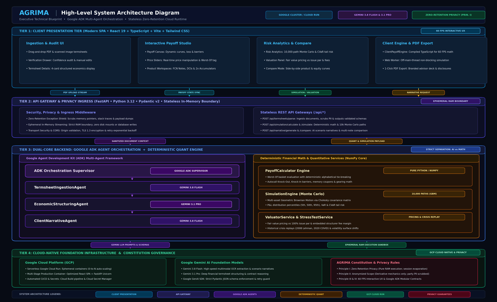
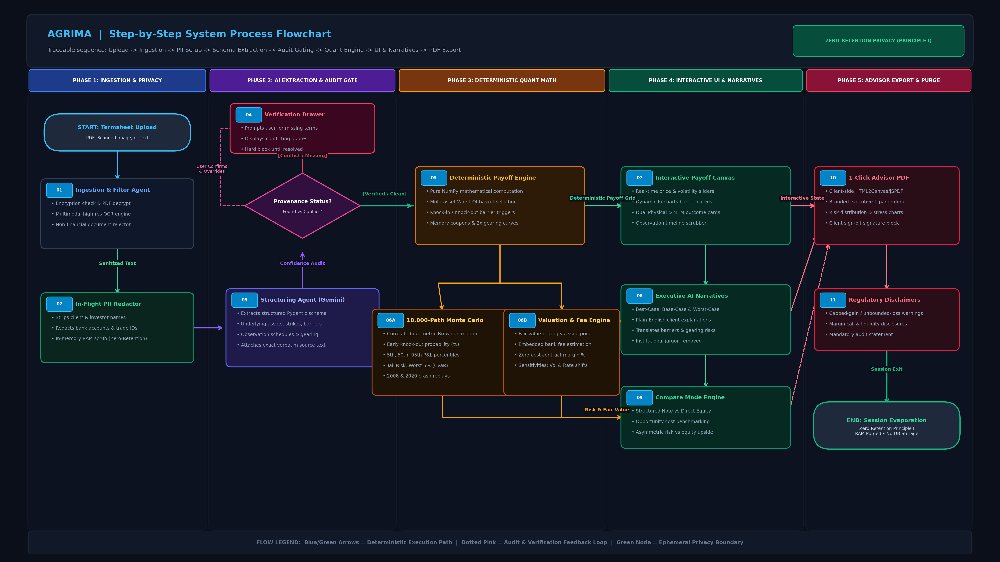

# AGRIMA | Smart Termsheet Scanner & Interactive Payoff Explainer

[](https://agrima-explainer-832118606636.us-central1.run.app/)
[](https://youtu.be/4VyEic7K1TI)
[](https://github.com/Karthi1908/AGRIMA)

AGRIMA is an intelligent, agent-driven financial technology application designed to demystify complex OTC structured products. By ingesting standard termsheet PDFs and image scans, AGRIMA automatically extracts economic parameters, models contractual payoff structures, and delivers dynamic, 60 FPS interactive simulations alongside plain-language scenario explanations.

---

## 🔗 Quick Links & Resources

* 🌐 **Live Cloud Prototype**: [https://agrima-explainer-832118606636.us-central1.run.app/](https://agrima-explainer-832118606636.us-central1.run.app/)
* 🎥 **YouTube Video Walkthrough**: [https://youtu.be/4VyEic7K1TI](https://youtu.be/4VyEic7K1TI)
* 💻 **GitHub Repository**: [https://github.com/Karthi1908/AGRIMA](https://github.com/Karthi1908/AGRIMA)

---

## 🌟 Key Features

* **Automated Multimodal Termsheet Extraction**: Powered by Google Gemini models, AGRIMA ingests complex, unstructured PDF documents and scanned termsheets, extracting economic parameters (strikes, barriers, coupons, observation schedules) into strictly validated schemas.
* **Deterministic Interactive Payoff Simulation**: Manipulate market price sliders and barrier thresholds in real time with immediate visual feedback across knock-in, knock-out, and 2x geared accumulation states.
* **AI-Generated Plain-Language Narratives**: Automatically synthesizes Best-Case, Base-Case, and Worst-Case investor narratives in neutral, plain language free from technical jargon.
* **Multi-Product Derivative Coverage**: Full support for:
  * **Dual Currency Investments (DCI)**
  * **Equity Autocallable Notes (FCNs, Step-Up, Step-Down, Twin-Win)**
  * **Equity Accumulators & Decumulators (with 2x Gearing & Guaranteed Periods)**
* **Risk Analytics & 10,000-Path Monte Carlo**: Integrated stochastic price simulations (GBM with Cholesky correlation matrix), VaR/CVaR tail-risk analytics, and indicative fair value pricing vs. 100% par.
* **Advisor-Ready 1-Click PDF Export**: Generates client-facing, branded presentation decks with audit provenance flags and regulatory disclosure blocks.

---

## 🏛️ System Architecture & Process Flow

### 1. High-Level System Architecture Diagram


### 2. End-to-End Process Flow Diagram


---

## 🛠️ Summary of Technologies Used

| Domain | Key Technologies | Core Purpose |
| :--- | :--- | :--- |
| **Frontend UI/UX** | **React 19**, **TypeScript**, **Vite**, **Tailwind CSS** | Ultra-responsive 60 FPS single-page application (SPA) with a curated dark-slate financial theme. |
| **Data Visualization** | **Recharts**, **Lucide Icons**, **SVG / Canvas** | Dynamic interactive payoff curves, barrier levels, and Monte Carlo P&L distribution charts. |
| **Client Quant Engine** | **Compiled TypeScript**, **HTML5 Web Workers** | Sub-millisecond client-side payoff math for instant slider feedback; non-blocking simulation execution. |
| **Backend & API Gateway** | **FastAPI**, **Python 3.12+**, **Pydantic v2**, **Uvicorn** | Asynchronous, high-throughput REST API with strict runtime contract validation and ephemeral memory streaming. |
| **Multi-Agent Framework** | **Google Agent Development Kit (ADK)** | Orchestrates specialized autonomous agents (`TermsheetIngestionAgent`, `EconomicStructuringAgent`, `ClientNarrativeAgent`). |
| **Foundation AI Models** | **Gemini 3.1 Pro** & **Gemini 3.8 Flash** *(Google GenAI SDK)* | **Gemini 3.1 Pro**: Deep contract structuring and financial reasoning.<br>**Gemini 3.8 Flash**: Fast multimodal OCR parsing and plain-language scenario narratives. |
| **Quantitative Math Engine**| **NumPy** *(Vectorized Cholesky & GBM)* | Deterministic 10,000-path Monte Carlo simulations, Worst-Of basket evaluation, and VaR/CVaR tail risk analytics. |
| **Cloud Runtime & Infra** | **Google Cloud Platform (GCP)**, **Cloud Run**, **Docker** | Stateless serverless container deployment with instant 0-to-N autoscaling and zero persistent disk mounts. |
| **Privacy & Security** | **Zero-Retention Ephemeral RAM Architecture** | Strict banking privacy standard: **0 persistent databases**, **0 disk writes**, and automated in-flight PII redaction. |
| **CI/CD & DevOps** | **Google Cloud Build**, **Google Secret Manager** | Automated container builds, continuous deployment, and zero-leak credential management. |

### Architectural Principles & Highlights
1. **Strict Separation of AI vs. Math**: Generative AI (Google Gemini) handles document understanding and natural language synthesis, while financial payoffs and risk simulations are strictly computed by deterministic Python and TypeScript engines to prevent hallucinations.
2. **60 FPS Client-Side Math**: A compiled TypeScript payoff engine runs calculations directly in the browser for instant slider interactivity without waiting for network calls.
3. **Zero-Retention by Design (Constitution Principle I)**: Complies with banking privacy requirements by keeping all uploaded documents, simulated portfolios, and client scenarios in transient memory that evaporates immediately post-session.

---

## 🚀 Getting Started

### Prerequisites
* **Node.js**: v18+
* **Python**: 3.12+
* **Google Gemini API Key**: [Google AI Studio](https://aistudio.google.com/)

### Installation

1. **Clone the repository:**
   ```bash
   git clone https://github.com/Karthi1908/AGRIMA.git
   cd AGRIMA
   ```

2. **Backend Setup:**
   Create a virtual environment, install dependencies, and configure environment variables:
   ```bash
   python -m venv .venv
   source .venv/bin/activate  # On Windows: .venv\Scripts\activate
   pip install -r backend/requirements.txt
   ```
   Create a `.env` file in the root directory:
   ```env
   GEMINI_API_KEY=your_gemini_api_key_here
   GEMINI_MODEL=gemini-2.5-flash
   GEMINI_PRO_MODEL=gemini-3.1-pro-preview
   ```

3. **Frontend Setup:**
   ```bash
   cd frontend
   npm install
   ```

### Running Locally

To run the full stack locally, start both the backend server and frontend development server:

**Start the Backend (FastAPI):**
```bash
# From the project root
python -m uvicorn backend.src.main:app --port 8000 --reload
```

**Start the Frontend (Vite):**
```bash
# From the frontend directory
npm run dev
```

Navigate to `http://localhost:5173` in your browser to start exploring termsheets!

---

## 🧪 Testing & Verification

AGRIMA includes comprehensive test fixtures and mathematical cross-checks:

```bash
# Run all backend unit and integration tests
pytest backend/tests/
```

---

## 🔒 Security & Privacy

* **Ephemeral In-Memory Processing**: Uploaded documents are read into RAM buffers, processed, and immediately discarded upon completion.
* **In-Flight Identity Scrubbing**: Institutional logos, counterparty names, bank account numbers, and investor details are scrubbed prior to LLM processing.
* **Zero Persistent Storage**: No persistent volumes, SQL/NoSQL databases, or server caches are mounted.

---

## 📜 License

[MIT License](LICENSE)
