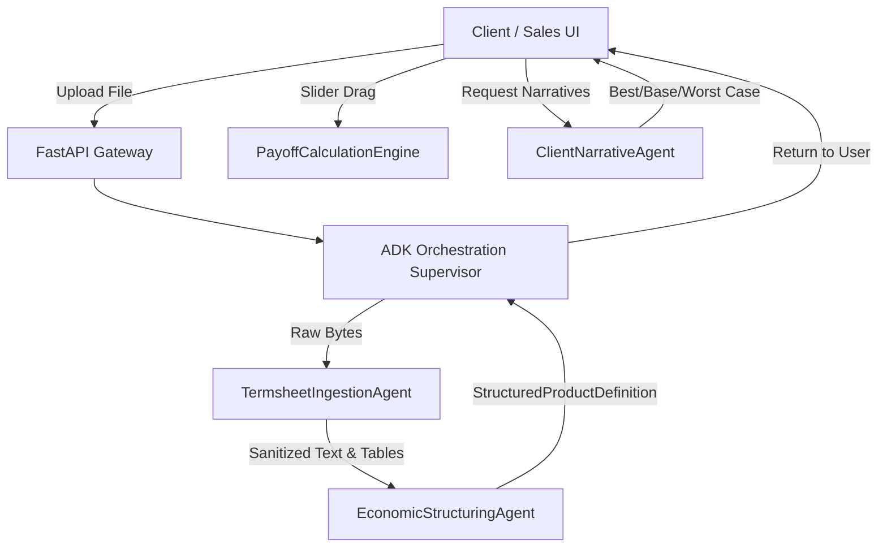

# Google Agent Development Kit (ADK) Agent Contracts

**Feature**: `001-termsheet-payoff-explainer`  
**Date**: 2026-09-27  
**Framework**: Google Agent Development Kit (ADK) + Gemini Models  

---

## 1. Architecture Overview

The system employs a supervisor-agent pattern where an ADK orchestrator routes execution through specialized agents with strictly typed input/output boundaries.

---

## 2. Agent 1: `TermsheetIngestionAgent`

- **Purpose**: Parse raw document bytes (PDF/PNG/JPEG), execute multimodal OCR, and redact all non-product information (issuers, buyers, accounts).
- **Gemini Model**: `gemini-2.5-flash`
- **System Instruction**:
  > You are a financial termsheet extraction and redaction specialist. Extract all textual content and tabular observation schedules from the provided document. Strictly ignore, redact, and exclude any counterparty information, issuing bank names, buyer names, investor contact details, and account numbers. Focus exclusively on product mechanics, underlying assets, strikes, barriers, and dates.
- **Input Contract**:
  - `document_bytes`: `bytes`
  - `mime_type`: `str` (`application/pdf`, `image/png`, `image/jpeg`)
- **Pre-Execution Checks**:
  - `pdf_encryption_checker`: Evaluates PDF header and encryption dictionary. If password protection or encryption is detected, immediately emits `rejection_reason="ENCRYPTED_PDF"` and halts before calling Gemini vision.
- **Retry & Reliability Policy**:
  - Automatically executes exponential backoff with up to 3 background retries (1s, 2s, 4s jitter) upon receiving transient 429/503 rate-limit or network timeout errors from the Gemini API.
- **Output Contract**:
  - `sanitized_content`: `str?` (clean Markdown representation of termsheet text and tables; null if rejected)
  - `is_rejected`: `bool`
  - `rejection_reason`: `str?` (`"ENCRYPTED_PDF"`, `"UNRECOGNIZED_STRUCTURE"`, or null)
  - `rejection_guidance`: `str?` (Actionable explanation with supported archetypes)
  - `redaction_summary`: `List[str]` (types of identifying information detected and stripped)
- **Tools**:
  - `pdf_encryption_checker`: Detects password locks and DRM flags.
  - `pdf_page_renderer`: Renders high-resolution image frames from multi-page PDFs for Gemini multimodal input.

---

## 3. Agent 2: `EconomicStructuringAgent`

- **Purpose**: Normalize unstructured termsheet text and tables into the typed `StructuredProductDefinition` schema, classify the product archetype, and compute field extraction confidence.
- **Gemini Model**: `gemini-2.5-pro`
- **System Instruction**:
  > You are a derivative structuring expert. Map the sanitized termsheet text into a valid JSON conforming to the StructuredProductDefinition schema. Classify the archetype into one of: DCI, EQUITY_AUTOCALL_OPTION, EQUITY_AUTOCALL_SWAP, FCN_AUTOCALL_NOTE, TWIN_WIN_NOTE, STEP_UP_AUTOCALL_NOTE, STEP_DOWN_AUTOCALL_NOTE. For knock-in barriers, default to European observation (evaluated at maturity) unless the termsheet explicitly specifies American continuous or daily monitoring. If the text does not describe any supported structured product archetype, emit rejection_reason="UNRECOGNIZED_STRUCTURE". For any parameter where the document is vague or ambiguous, provide your best estimate, set the corresponding field confidence < 0.7, and emit an explicit warning message.
- **Input Contract**:
  - `sanitized_content`: `str`
- **Output Contract**:
  - `product`: `StructuredProductDefinition?`
  - `field_confidence`: `Dict[str, float]`
  - `flagged_warnings`: `List[str]`
  - `is_rejected`: `bool`
  - `rejection_reason`: `str?`
  - `rejection_guidance`: `str?`
- **Tools**:
  - `pydantic_schema_validator`: Validates candidate JSON against the strict Pydantic model before returning.

---

## 4. Component 3: `PayoffCalculationEngine` (Deterministic Tool)

- **Purpose**: Calculate mathematical payoff, observation events, and barrier outcomes without LLM latency or hallucination.
- **Execution**: Deterministic Python calculation module (also compiled to client-side TypeScript for zero-latency 60fps sliders).
- **Functions**:
  1. `evaluate_worst_of(underlyings: List[UnderlyingAsset]) -> Tuple[UnderlyingAsset, List[UnderlyingAsset], Optional[str]]`:
     Computes performance percentage of each asset: `(simulated - initial) / initial` and identifies the minimum. If multiple assets share the identical lowest return, breaks ties alphabetically by ticker symbol and returns all tied assets plus `worst_of_tie_broken_by="ALPHABETICAL_SYMBOL"`.
  2. `evaluate_autocall_status(schedule: List[BarrierObservation], worst_perf_pct: float) -> Tuple[bool, Optional[int]]`:
     Iterates observation dates to determine if knock-out barrier was satisfied.
  3. `evaluate_maturity_payout(product: StructuredProductDefinition, worst_perf_pct: float, is_knocked_in: bool) -> PayoutBreakdown`:
     Applies archetype-specific maturity payoff formula (DCI currency conversion, Twin-Win absolute return, FCN put-to-stock conversion) factoring in European vs. American knock-in status.

---

## 5. Agent 4: `ClientNarrativeAgent`

- **Purpose**: Transform numerical payoff schedules and barrier limits into intuitive, executive-ready plain-language summaries.
- **Gemini Model**: `gemini-2.5-flash`
- **System Instruction**:
  > You are a private wealth investment advisor communication specialist. Given a structured product definition and its barrier parameters, generate three crystal-clear, plain-language scenarios: Best Case, Base Case, and Worst Case. Use clear bullet points. Clearly explain under what market conditions the investor receives full return of principal, when coupons are paid, and what triggers downside risk or capital loss. Avoid jargon. Do not mention any financial entity or advisor identity.
- **Input Contract**:
  - `product`: `StructuredProductDefinition`
- **Output Contract**:
  - `best_case`: `str`
  - `base_case`: `str`
  - `worst_case`: `str`
