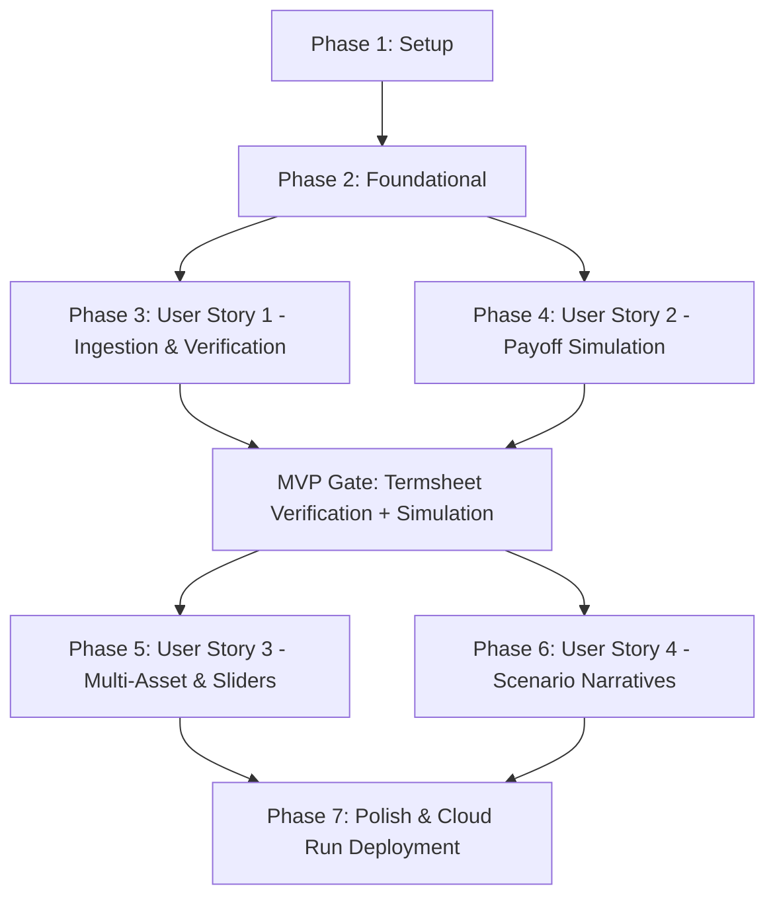

# Implementation Tasks: Smart Termsheet Scanner & Interactive Payoff Explainer

**Feature**: `001-termsheet-payoff-explainer`  
**Plan**: [plan.md](plan.md) | **Spec**: [spec.md](spec.md)  
**Status**: Ready for Implementation  

---

## Phase 1: Setup (Shared Infrastructure)

**Purpose**: Initialize project workspace, environments, seed termsheet fixtures, and basic directory scaffolding.

- [X] T001 Create project directory scaffolding per plan in `backend/` and `frontend/`
- [X] T002 Configure backend Python project dependencies (`fastapi`, `uvicorn`, `google-genai`, `pydantic`, `pypdf`, `pdf2image`, `pillow`, `python-multipart`, `pytest`) in `backend/requirements.txt`
- [X] T003 [P] Initialize frontend Vite + TypeScript application with charting and icon dependencies in `frontend/package.json`
- [X] T004 [P] Configure frontend TypeScript compiler configuration and path aliases in `frontend/tsconfig.json` and `frontend/vite.config.ts`
- [X] T005 [P] Create seed mock termsheet fixtures across 4 archetypes (DCI, FCN, Step-Down Autocall, Twin-Win) and invalid/encrypted files in `backend/tests/fixtures/`

---

## Phase 2: Foundational (Blocking Prerequisites)

**Purpose**: Core data models, API routing skeleton, and styling tokens that MUST be complete before user story work begins.

- [X] T006 Implement Pydantic v2 core domain models and enums with European/American observation types, worst-of tie fields, and rejection schemas in `backend/src/models/schemas.py`
- [X] T007 [P] Implement frontend TypeScript types matching OpenAPI contract in `frontend/src/types/index.ts`
- [X] T008 [P] Create modern design system and CSS tokens (dark/light themes, glassmorphism overlays, barrier color accents) in `frontend/src/styles/theme.css`
- [X] T009 Setup FastAPI application shell with CORS, error handling middleware, and stateless lifecycle in `backend/src/main.py`
- [X] T010 [P] Implement base API router module in `backend/src/api/routes.py`

**Checkpoint**: Core schemas, styling tokens, and API skeleton established. User story implementation can now proceed.

---

## Phase 3: User Story 1 - Termsheet Upload, Sanitized Extraction & Parameter Verification (Priority: P1) 🎯 MVP Part 1

**Goal**: Allow sales specialists and clients to upload PDF or image termsheets, strip all counterparty/client identities, handle password-locked and non-financial files gracefully, and verify extracted economic parameters in an interactive drawer.

**Independent Test**: Upload sample termsheets (PDF/images) across supported archetypes via UI/API, verify that counterparty PII is completely stripped, confirm that password-protected and non-financial files show clear rejection banners, and verify that all extracted economic parameters populate the verification drawer with editable fields and amber warning flags.

### Tests for User Story 1
- [X] T011 [P] [US1] Unit test for PII redaction and party identity scrubbing in `backend/tests/test_sanitization.py`
- [X] T012 [P] [US1] Contract test for termsheet parsing endpoint (`/api/termsheets/parse`) including rejection payloads in `backend/tests/test_structuring_agent.py`

### Implementation for User Story 1
- [X] T013 [P] [US1] Implement PDF/image preprocessing with `pdf_encryption_checker` for password detection in `backend/src/agents/ingestion_agent.py`
- [X] T014 [US1] Implement `TermsheetIngestionAgent` with Gemini 2.5 Flash, 3-retry exponential backoff, PII redaction, and non-financial document detection in `backend/src/agents/ingestion_agent.py`
- [X] T015 [US1] Implement `EconomicStructuringAgent` with Gemini 2.5 Pro defaulting to European observation with dynamic American detection in `backend/src/agents/structuring_agent.py`
- [X] T016 [US1] Implement termsheet upload endpoint `POST /api/termsheets/parse` returning structured data or rejection guidance in `backend/src/api/routes.py`
- [X] T017 [P] [US1] Create drag-and-drop file upload component (`UploadZone`) with skeleton loaders, retry action, and rejection banner in `frontend/src/components/UploadZone.tsx`
- [X] T018 [US1] Create interactive parameter verification drawer (`VerificationDrawer`) with amber badges for low-confidence fields in `frontend/src/components/VerificationDrawer.tsx`

**Checkpoint**: User Story 1 complete. Termsheets can be uploaded, validated, scrubbed of PII, and verified in the drawer.

---

## Phase 4: User Story 2 - Dynamic Interactive Payoff Diagram & Barrier Simulation (Priority: P1) 🎯 MVP Part 2

**Goal**: Deliver real-time 60fps payoff diagrams allowing users to manipulate market price and observation sliders to visualize knock-in (European/American), knock-out, and maturity outcomes for single-asset and DCI products.

**Independent Test**: Adjust market price sliders on verified product parameters and confirm the 2D payoff curve, barrier lines, and return percentages update fluidly in under 100ms.

### Tests for User Story 2
- [X] T019 [P] [US2] Unit test for deterministic payoff formulas (autocall knock-out, coupon memory, European vs. American knock-in, DCI FX conversion) in `backend/tests/test_payoff_calculator.py`
- [X] T020 [P] [US2] Contract test for simulation calculation endpoint (`/api/simulation/calculate`) in `backend/tests/test_simulation_api.py`

### Implementation for User Story 2
- [X] T021 [P] [US2] Implement deterministic payoff calculation engine supporting European and American barrier monitoring in `backend/src/engine/payoff_calculator.py`
- [X] T022 [US2] Implement simulation calculation endpoint `POST /api/simulation/calculate` in `backend/src/api/routes.py`
- [X] T023 [P] [US2] Implement client-side zero-latency mathematical scenario engine in `frontend/src/engine/client_payoff_engine.ts`
- [X] T024 [US2] Implement high-performance 2D interactive payoff chart component (`PayoffCanvas`) with color-coded barrier zones in `frontend/src/components/PayoffCanvas.tsx`
- [X] T025 [P] [US2] Implement DCI strike and currency conversion controls (`DciControls`) in `frontend/src/components/DciControls.tsx`
- [X] T026 [US2] Assemble main application shell integrating upload, verification drawer, and payoff canvas in `frontend/src/App.tsx`

**Checkpoint**: User Story 2 complete. Standalone MVP ready with termsheet ingestion and dynamic 60fps payoff simulation.

---

## Phase 5: User Story 3 - Multi-Asset & Multi-Currency Scenario Exploration (Priority: P2)

**Goal**: Allow sales specialists and clients to manipulate independent sliders for each stock in multi-underlying baskets (FCNs), with automatic worst-of tracking, alphabetical tie-breaking, and multi-currency exchange rates.

**Independent Test**: Load a 3-stock FCN, adjust individual stock sliders independently, test tied returns to verify alphabetical tie-breaking and the "Tied Worst-Of" badge, and observe Step-Up/Down and Twin-Win hurdle curves.

### Implementation for User Story 3
- [X] T027 [P] [US3] Implement multi-asset worst-of evaluation and alphabetical symbol tie-breaking in `backend/src/engine/payoff_calculator.py` and `frontend/src/engine/client_payoff_engine.ts`
- [X] T028 [US3] Implement independent slider control panel (`MultiAssetSliders`) with real-time worst-of and "Tied" badge highlighting in `frontend/src/components/MultiAssetSliders.tsx`
- [X] T029 [US3] Implement Step-Up and Step-Down visual hurdle progression rendering in `frontend/src/components/PayoffCanvas.tsx`
- [X] T030 [US3] Implement Twin-Win dual-slope payoff curve visualization in `frontend/src/components/PayoffCanvas.tsx`

**Checkpoint**: User Story 3 complete. Multi-underlying basket FCNs, Step-Up/Down, and Twin-Win notes fully supported.

---

## Phase 6: User Story 4 - Plain-Language Scenario Narratives & Ephemeral Client Summary (Priority: P3)

**Goal**: Synthesize crystal-clear, non-technical plain-language narratives for Best Case, Base Case, and Worst Case scenarios, with complete session reset capabilities for client privacy.

**Independent Test**: Trigger narrative generation on an active product and verify that three plain-language cards explain maximum return, capital protection, and downside barrier risk with zero retained session state upon browser reload.

### Tests for User Story 4
- [X] T031 [P] [US4] Contract test for narrative generation endpoint (`/api/narrative/generate`) in `backend/tests/test_narrative_agent.py`

### Implementation for User Story 4
- [X] T032 [US4] Implement `ClientNarrativeAgent` using Gemini 2.5 Flash with structured prompt framing in `backend/src/agents/narrative_agent.py`
- [X] T033 [US4] Implement narrative generation endpoint `POST /api/narrative/generate` in `backend/src/api/routes.py`
- [X] T034 [P] [US4] Create plain-language narrative display cards (`NarrativeCards`) in `frontend/src/components/NarrativeCards.tsx`
- [X] T035 [US4] Implement session clear and ephemeral data wipe controls in `frontend/src/App.tsx`

**Checkpoint**: User Story 4 complete. Full product explainer lifecycle with plain-language summaries operational.

---

## Phase 7: Polish & Cross-Cutting Concerns

**Purpose**: Containerization for Google Cloud Run deployment, end-to-end integration validation, and security auditing.

- [X] T036 [P] Create multi-stage container build configuration for backend and frontend in `Dockerfile`
- [X] T037 [P] Create Google Cloud Build and Cloud Run deployment configuration in `cloudbuild.yaml`
- [X] T038 Perform end-to-end scenario validation following `quickstart.md` workflows across all 4 product archetypes using seed fixtures
- [X] T039 Audit backend and frontend logging to verify absolute zero persistence of client inputs and parsed document text

---

## Dependencies & Execution Order

### Parallel Opportunities

- **Setup & Foundational**:
  - T003 (Frontend package), T004 (TS config), and T005 (Seed fixtures) can run in parallel with T002 (Backend requirements).
  - T007 (TS Types) and T008 (CSS Theme) can run in parallel with T006 (Pydantic Models).
- **User Story 1**:
  - T011, T012 (Tests) and T013 (Encryption check), T017 (UploadZone) can proceed in parallel.
- **User Story 2**:
  - T019, T020 (Tests) and T021 (Math engine), T023 (Client engine) can proceed in parallel.
- **User Story 3 & 4**:
  - User Story 3 (UI sliders) and User Story 4 (Gemini narratives) touch distinct files and can execute concurrently.

---

## Implementation Strategy

### MVP First (Phases 1-4)
1. Complete Phase 1 (Setup & Seed Fixtures) and Phase 2 (Foundational).
2. Complete Phase 3 (US1: Ingestion, Encryption Checks, Verification Drawer).
3. Complete Phase 4 (US2: Payoff Simulation Engine & 60fps Canvas).
4. **Validate MVP**: Upload a standard single-asset or DCI termsheet, verify parameters, and dynamically manipulate the 60fps payoff graph.

### Incremental Feature Additions
5. Deliver Phase 5 (US3: Multi-stock worst-of sliders, alphabetical tie-break, Step-Up/Down, Twin-Win).
6. Deliver Phase 6 (US4: Gemini plain-language Best/Base/Worst case narratives).
7. Deliver Phase 7 (Cloud Run deployment and zero-retention privacy audit).
